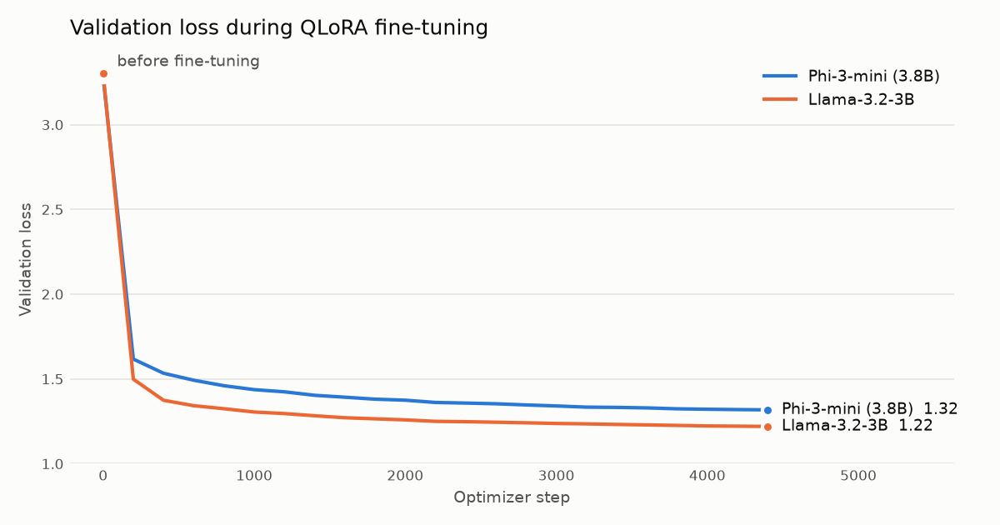

# English → Hinglish Translation with QLoRA

Fine-tuning small open LLMs (**Phi-3-mini 3.8B** and **Llama-3.2-3B**) to translate English into natural, conversational **Hinglish** (Hindi written in Latin script, mixed with English), using **QLoRA** on a single free Colab T4 GPU.

| English | Base Phi-3-mini | Fine-tuned Phi-3-mini |
|---|---|---|
| What is the weekend weather ? | क्या वह वहाँ का वहाँ का वहाँ का… | weekend ka weather kya hai ? |
| reset the microwave alarm so it only dings once | मैकेवर का टीम कर लोग, इसका टीम… | microwave alarm ko reset karo so it only dings once. |
| Remind me to pack my bags for the vacation in the morning . | ### Response: | mujhe subah vacation ke liye mere bags pack karne ke liye yaad dilaye . |

## Highlights

- **Large gains from training ~0.25% of the parameters:** chrF++ against reference translations rises from **2.6 → 52.1** (Phi-3-mini) and **11.2 → 52.6** (Llama-3.2-3B). Output in Romanized script goes from 11% / 33% to **100%**.
- **QLoRA end to end:** 4-bit NF4 base with double quantization, k-bit training preparation, gradient checkpointing, and LoRA adapters on the attention projections, chosen per architecture.
- **Two model families compared** under identical settings. The trained adapters (38 MB and 18 MB) ship in [`results/`](results/) and can be used right away.
- **Learned from the runs:** reviewing the outputs exposed repetition and evaluation bugs, which are now fixed in the code (loss masking, EOS, token-based decoding). See [What the first experiments showed](docs/DESIGN.md#what-the-first-experiments-showed).
- **Reproducible:** all settings live in `config.py`, every run saves its config and loss history, and `scripts/run_pipeline.sh` runs the whole thing in one command.

See **[docs/DESIGN.md](docs/DESIGN.md)** for the reasoning behind each choice.

## Results

Both models were trained on 18,000 pairs from [findnitai/english-to-hinglish](https://huggingface.co/datasets/findnitai/english-to-hinglish) for 2 epochs (4,500 steps) on a Colab T4, with identical hyperparameters.

<p align="center"></p>

| | Phi-3-mini (3.8B) | Llama-3.2-3B |
|---|---|---|
| Validation loss, before → after | 3.28 → **1.32** | 3.30 → **1.22** |
| chrF++ on 100 samples, base → fine-tuned | 2.6 → **52.1** | 11.2 → **52.6** |
| BLEU on 100 samples, base → fine-tuned | 0.4 → **22.1** | 5.1 → **23.5** |
| Outputs in Romanized script, base → fine-tuned | 11% → **100%** | 33% → **100%** |
| LoRA targets / adapter size | `qkv_proj`, `o_proj` / 38 MB | `q_proj`, `v_proj` / 18 MB |

**What changed:** the base models mostly answer in Devanagari Hindi, echo the English unchanged, or ramble. After fine-tuning, both consistently produce Romanized Hinglish close to the reference style.

| English | Reference | Fine-tuned Phi-3-mini | Fine-tuned Llama-3.2-3B |
|---|---|---|---|
| I know. I love them both, and I love that movie. | muje patha hein muje is movie aur dono ko pasand hein | mujhe pata hai. mujhe unhe bahut pasand hai, aur mujhe is movie bahut pasand hai. | muje pata he. muje un dono pasand he aur muje us movie pasand he. |
| How long would it take to travel 20 miles going 60 miles per hours | 60 miles per hour ke speed se 20 miles travel karne mei kitni der lagegi | 60 miles per hour se 20 miles travel karne mei kitni der lagegi ? | 60 miles per hours se 20 miles travel karne me kitna time lagega? |
| Moonstone seems like an interesting name for a boat | moonstone yis nav ke liye dilchusp nam lega | Moonstone ek interesting name hai ek boat ke liye. Moonstone ek interesting name hai… | Moonstone boat ke liye interesting name lagta hai. |
| when are we getting rain ? | baarish kab aa rahi hai ? | hum baarish kab hogi ? ? ? ? ? ? ? ? … | hume rain kab milne wali hai? |

All 100 samples for each model are in `results/*/sample_translations.csv`.

**Caveats:**
- The 100 samples came from the same pool as the training data, so about 90% were seen during training. The chrF++/BLEU numbers show the base-vs-fine-tuned gap, not how well the models generalize. A clean held-out test is the next step.
- These runs used an earlier objective with no EOS token, which is why some outputs repeat (last two rows above). The current code fixes this ([details](docs/DESIGN.md#what-the-first-experiments-showed)).
- Metrics use the first line of each output and are computed by [`utils/summarize_results.py`](utils/summarize_results.py), which needs no GPU.

## How it works

```
 HF Hub datasets ──► utils/prepare_training_data.py ──► data/*.json  {"input": en, "output": hinglish}
                                                            │
                                                            ▼
                       training/dataset.py   prompt template + EOS, mask prompt tokens in labels
                                                            │
 Phi-3-mini / Llama (4-bit NF4) ◄── training/model.py       ▼
          │                                    train.py  (HF Trainer + PEFT LoRA)
          └──────────────────────────────────────────►  LoRA adapter (18–38 MB)
                                                            │
                                                            ▼
                                                 infer.py  base model + adapter → Hinglish
```

## Project structure

```
├── config.py                     # models, prompt template, hyperparameters, LoRA config, paths
├── train.py                      # fine-tuning entry point (CLI)
├── infer.py                      # translate with an adapter; --compare against the base model
├── training/
│   ├── dataset.py                # loading, prompt formatting, tokenization + loss masking
│   └── model.py                  # base model / tokenizer loading with 4-bit or 8-bit quantization
├── utils/
│   ├── prepare_training_data.py  # downloads findnitai + HinGE datasets into data/
│   └── summarize_results.py      # loss chart + chrF++/BLEU from results/ (CPU only)
├── scripts/
│   └── run_pipeline.sh           # install → data → train → sample translations
├── results/
│   ├── phi3-mini/                # adapter/, run_info.json, trainer_state.json, sample_translations.csv
│   ├── llama-3.2-3b/             # same layout
│   ├── validation_loss.png
│   └── metrics.json
├── data/                         # prepared JSON datasets
└── docs/DESIGN.md                # design decisions, lessons learned, next steps
```

## Setup

**Requirements:** Python 3.10+. Training and fast inference need an NVIDIA GPU with CUDA (a free Colab T4 with 16 GB is enough). On CPU or Apple Silicon you can run the smoke test and `utils/summarize_results.py`.

```bash
git clone https://github.com/jodha-rituraj/hinglish-translation-qlora.git
cd hinglish-translation-qlora

python -m venv .venv && source .venv/bin/activate
pip install -r requirements.txt
```

Phi-3-mini is not gated. For Llama or Gemma, first accept the model license on the Hugging Face Hub, then run `huggingface-cli login`.

## Usage

### Try the trained adapters

```bash
python infer.py --text "Where are you going tonight?"                    # Phi-3-mini adapter (default)
python infer.py --compare --text "I will call you after the meeting."    # base vs fine-tuned
python infer.py --adapter_path results/llama-3.2-3b/adapter --text "Is it going to rain today?"
```

### Reproduce the training run

One command (works on Colab too):

```bash
bash scripts/run_pipeline.sh                                                   # Phi-3-mini, as reported
bash scripts/run_pipeline.sh --model_name meta-llama/Llama-3.2-3B               # Llama run
```

**On Google Colab** (Runtime → Change runtime type → T4 GPU):

```python
!git clone https://github.com/jodha-rituraj/hinglish-translation-qlora.git
%cd hinglish-translation-qlora
!bash scripts/run_pipeline.sh
```

Or step by step:

```bash
python utils/prepare_training_data.py --dataset findnitai   # data/eng_hinglish_train.json is already included
python train.py                                             # defaults = the reported setup
python train.py --data_path data/hinge_train.json --max_samples 0   # all of HinGE instead
python train.py --help                                      # all options
python infer.py --adapter_path outputs/adapter --compare --text "..."
```

To check the pipeline works on a laptop (CPU, 5 steps, tiny model, no quantization):

```bash
python train.py --smoke_test --quantization none --model_name HuggingFaceTB/SmolLM2-135M
```

New runs write to `outputs/` (git-ignored):

```
outputs/
├── adapter/            # final LoRA adapter + tokenizer
├── checkpoints/        # intermediate checkpoints (best 2 kept)
├── log_history.json    # training / validation loss per logging step
└── run_config.json     # exact arguments used
```

## Configuration

All defaults are in [`config.py`](config.py) and most can be overridden from the CLI:

| Setting | Default |
|---|---|
| Base model | `microsoft/Phi-3-mini-4k-instruct` |
| Data | `data/eng_hinglish_train.json`, first 20,000 pairs, 10% validation |
| Quantization | 4-bit NF4, double quantization |
| LoRA | r=16, α=32, dropout=0.05 |
| Learning rate | 2e-4, linear decay, 30 warmup steps |
| Effective batch size | 8 (1 × 8 gradient accumulation) |
| Epochs | 2 |

## Datasets

- [findnitai/english-to-hinglish](https://huggingface.co/datasets/findnitai/english-to-hinglish): ~189k conversational pairs (used for the reported runs)
- [LingoIITGN/HinGE](https://huggingface.co/datasets/LingoIITGN/HinGE): human-written Hinglish with multiple references per sentence

Datasets and base models are governed by their own licenses.

## Next steps

- Evaluate on a clean held-out test split (chrF++ / BLEU)
- Re-train with the fixed objective (loss masking + EOS) and measure the drop in repetition
- Publish the adapters to the Hugging Face Hub

## License

Code is released under the [MIT License](LICENSE).
